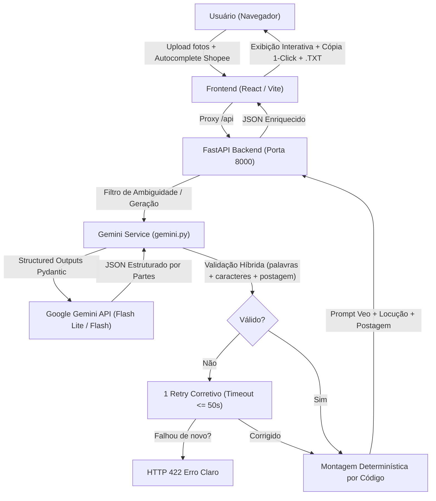

# Arquitetura e Funcionamento Completo de Ponta a Ponta: Mestre Gerador v3.0 (Operação Veo3)

O **Mestre Gerador** é uma solução completa de ponta a ponta projetada para transformar fotos e notas de produtos da **Shopee** e **TikTok Shop** em **roteiros ultra-persuasivos de neurovendas** e **prompts de vídeo contínuos de 10 segundos** prontos para o **Google Veo (Veo3)**, além de gerar os **dados de postagem SEO** (Título, Legenda e Hashtags).

---

## 1. Visão Geral da Arquitetura

O sistema opera com separação estrita de responsabilidades:
- **Frontend SPA**: React 19 + TypeScript + Vite + Tailwind CSS v4.
- **Backend API**: FastAPI (Python 3.14) + Pydantic v2 + Google GenAI SDK.
- **Camada de Inteligência Artificial**: Google Gemini API com fallback automático de modelos (`gemini-3.5-flash-lite` -> `gemini-3.1-flash-lite` -> `gemini-3.8-flash`).
- **Módulo Opcional de Montagem (Legado)**: Script CLI `montador.py` com FFmpeg e Gemini TTS (exige 3 clipes separados).



---

## 2. Fluxo do Ciclo de Vida da Requisição

### Passo 1: Captura de Mídia e Entradas no Cliente ([`ImageDrop.tsx`](../frontend/src/components/ImageDrop.tsx))
1. **Até 4 Imagens do Produto**:
   - Suporte a arrastar e soltar (drag & drop), seleção manual de arquivos ou colar diretamente com <kbd>Ctrl+V</kbd>.
   - A Foto 1 é marcada como **Start Frame** obrigatório do vídeo; fotos 2, 3 e 4 servem como referências de textura e ângulos.
   - **Compressão Automática no Cliente via `<canvas>`**: redimensiona imagens para no máximo 1280px e comprime em JPEG (qualidade 0.85), acelerando o upload.
2. **Contexto e Link**: Campo de texto para links de anúncio ou observações como preço, benefícios principais e público-alvo.
3. **Termos do Autocomplete Shopee**: Campo onde o afiliado cola as sugestões de busca da Shopee/TikTok para travar o Título SEO usando apenas palavras pesquisadas de verdade.

---

### Passo 2: O Filtro de Ambiguidade (Tech Lemonade Logic)
Ao clicar em **"Diagnosticar & Gerar Roteiro"**:
1. O backend avalia se o produto é específico ou ambíguo:
   - **Se o produto tiver múltiplos ângulos de venda ou for genérico sem contexto**: a IA ativa `status: 'needs_clarification'`, gerando de 1 a 2 perguntas de múltipla escolha com 3 alternativas diagnósticas.
   - O frontend exibe a [`ClarificationBox.tsx`](../frontend/src/components/ClarificationBox.tsx) para o usuário escolher o diferencial (ex: foco no tecido, no caimento ou na durabilidade).
2. Se o usuário clicar em **"Geração Direta (Sem Perguntas)"** ou se o produto já for específico, a IA avança direto para `status: 'completed'`.

---

### Passo 3: Engenharia de Prompt e Regras Cirúrgicas ([`system.py`](../backend/app/prompts/system.py))

O system prompt força o modelo a nunca devolver texto monolítico, mas sim **partes estruturadas**:

| Parte Retornada | Idioma | Regra Rígida de Negócio |
| :--- | :--- | :--- |
| `descricao_produto` | Inglês | Ancoragem física rígida ("Anchor Prompts") com gravidade e peças conectadas à foto. |
| `descricao_cenario` | Inglês | Bancada ou superfície limpa, iluminação comercial suave estável ao longo de todo o vídeo. |
| `multiple_hooks` | PT-BR / Inglês | **3 Opções (Dor, Curiosidade, Quebra de Padrão)**. **Regra de Movimento Extremo**: ação física imediata nos primeiros 3s (proibido produto parado ou *"slowly rotating"*). |
| `bloco_beneficio_visual` | Inglês | Demonstração prática do produto sem alucinações de especificações que não constam no anúncio. |
| `fala_beneficio` | PT-BR | *(ver constantes em `backend/app/services/gemini.py`)*. |
| `bloco_cta_visual` | Inglês | Hero shot cinematográfico que **obrigatoriamente repete a ancoragem estrutural** das partes do produto. |
| `fala_cta` | PT-BR | Chamada para ação de clique no carrinho: *(ver constantes em `backend/app/services/gemini.py`)*. |
| `titulo_seo` | PT-BR | Composto **estritamente com os termos do autocomplete** informados pelo usuário. |
| `legenda_na_tela` | PT-BR | Sticker/gancho visual para tela com **no máximo 5 palavras**. |
| `hashtags` | PT-BR | Lista estratégica de nicho onde **a última hashtag é obrigatoriamente `#publicidade`**. |

> [!IMPORTANT]
> **Fuga de Propriedade Intelectual & Coerência Anti-Texto**:
> O modelo é instruído a **nunca solicitar close-ups em logotipos**, escudos de times ou tipografia. Como o Veo3 não renderiza letras em inglês ou português, tentar forçar logotipos resulta em borrões plásticos derretidos. A IA foca 100% em **textura pura do material** (*"breathable woven fabric"*), cor e anatomia funcional.

---

### Passo 4: Validação Híbrida e 1 Retry sem Loop ([`gemini.py`](../backend/app/services/gemini.py))

O backend não confia na contagem de palavras do modelo (que frequentemente alucina). Todas as contagens são calculadas em Python (`len(fala.split())` e `len(fala)`):

As hipóteses numéricas de limites de palavras e caracteres estão centralizadas em constantes calibráveis *(ver constantes em `backend/app/services/gemini.py`)*.

1. **Validação da Locução**:
   - Cada gancho: limites de palavras e caracteres *(ver constantes em `backend/app/services/gemini.py`)*.
   - Benefício: limites de palavras e caracteres *(ver constantes em `backend/app/services/gemini.py`)*.
   - CTA: limites de palavras e caracteres *(ver constantes em `backend/app/services/gemini.py`)*.
   - Total somado: faixa de palavras e teto de caracteres *(ver constantes em `backend/app/services/gemini.py`)*.
2. **Validação dos Campos de Postagem**:
   - `legenda_na_tela` $\le 5$ palavras.
   - `hashtags[-1].lower() == "#publicidade"`.
3. **Mecanismo de Correção**:
   - Se qualquer regra for violada, o backend executa **exatamente 1 retry corretivo** informando à IA os erros exatos para que ela reescreva e encurte o JSON.
   - Se o retry falhar novamente, a API retorna `HTTP 422 Unprocessable Entity` com detalhes claros.
   - Toda a operação é governada pelo prazo limite do backend *(ver constantes em `backend/app/services/gemini.py`)*, abortando antes dos 60 segundos do timeout do React.

---

### Passo 5: Montagem Determinística por Código ([`gemini.py`](../backend/app/services/gemini.py))

O `prompt_veo` e a `locucao_pt` são montados através de templates estritos em Python:

```python
VEO_HEADER_TEMPLATE = (
    "Using the provided product photo as reference: {descricao_produto}, placed on {descricao_cenario}. "
    "Clean commercial footage, clean surfaces, plain background, "
    "all product parts firmly anchored with rigid physical connections and realistic gravity, no floating parts, no morphing structures, "
    "no phone screens, no UI interfaces, no fake app mockups, "
    "no subtitles, no on-screen text, no background music, no other voices, no text, no letters, no words."
)

VEO_BLOCK_0_3_TEMPLATE = (
    '[0-3s]: {acao_visual_0_3s} '
    'Portuguese voiceover narration says: "{fala}" in a natural, clear tone (no background music, no other voices).'
)
# Idem para blocos [3-7s] e [7-10s]
```

---

### Passo 6: Interface e Apresentação ([`ScriptTable.tsx`](../frontend/src/components/ScriptTable.tsx))

A interface exibe o roteiro pronto com ferramentas práticas de cópia:

1. **Card 1 - Diagnóstico do Diretor de Vídeo**:
   - Badge rastreando o modelo que gerou (`⚙️ Gerado por: gemini-3.5-flash-lite`).
   - Categoria do produto e resumo da estratégia de neurovendas.
   - Botões de **"Baixar .TXT"** e **"Copiar Roteiro Completo"**.
2. **Card 2 - Seletor de Ganchos A/B/C**:
   - Alternância interativa entre **Dor**, **Curiosidade** e **Quebra de Padrão**.
   - **Remontagem Instantânea**: clicar em outro gancho reconstrói na hora o prompt do Veo e a locução no cliente, sem gastar cota nem aguardar requisição.
3. **Card 3 - Prompt de Vídeo de 10s (Google Veo)**:
   - Texto pronto em inglês estruturado por blocos com botão de copiar em 1 clique.
4. **Card 4 - Locução em Português com Validador Híbrido**:
   - Texto corrido da narração sincronizada.
   - Badges coloridas com contagem em tempo real de palavras e caracteres por bloco e totais.
5. **Card 5 - Campos de Postagem (Shopee & TikTok)**:
   - **Título SEO**: com botão de cópia individual.
   - **Legenda na Tela / Sticker**: com indicador de $\le 5$ palavras e botão de cópia.
   - **Hashtags de Nicho**: tags formatadas com destaque visual especial para a tag obrigatória `#publicidade ★`.
6. **Card 6 - Tabela Legada de 3 Cenas**:
   - Renderizador retrocompatível para registros antigos salvos no `localStorage` antes da migração para o Veo3, garantindo que o histórico nunca quebre.

---

### Passo 7: Refinamento Iterativo ([`RefinementBox.tsx`](../frontend/src/components/RefinementBox.tsx))
Permite ao usuário solicitar ajustes pontuais (ex: *"deixe mais dinâmico"*, *"troque para curiosidade"* ou comandos customizados). A IA recebe o script anterior e altera apenas a variável estratégica solicitada, preenchendo o `refinement_summary`.

---

### Passo 8: Histórico Persistente no Navegador ([`App.tsx`](../frontend/src/App.tsx))
- Todos os roteiros gerados com sucesso são salvos na chave `mestre_gerador_saved_scripts_v4` do `localStorage` (últimos 20 registros).
- Drawer lateral acessível no topo da página permite recuperar qualquer roteiro anterior a qualquer momento.

---

## 3. Estrutura de Arquivos e Funções Detalhadas

```
Gerador/
├── start.bat                     # Inicializador único Windows (FastAPI + Vite + Chrome)
├── montador.py                   # Utilitário legado pós-produção (FFmpeg + Gemini TTS, exige 3 clipes)
├── docs/                         # Documentação técnica e regras do sistema
│   ├── visao_geral_projeto.md
│   └── regras_do_sistema.md
├── backend/
│   ├── .env                      # GEMINI_API_KEY e configurações
│   ├── requirements.txt          # fastapi, uvicorn, google-genai, pydantic, etc.
│   └── app/
│       ├── main.py               # Inicializador FastAPI, CORS e rotas
│       ├── core/config.py        # Configurações com Pydantic Settings
│       ├── api/routes.py         # Endpoints /api/generate-script e /api/health
│       ├── prompts/system.py     # System Prompt Mestre com regras de neurovendas e Veo3
│       ├── schemas/script.py     # Schemas Pydantic (Request, Output, Result, Partes)
│       └── services/gemini.py    # Cliente Gemini, timeouts, validação híbrida e retry
└── frontend/
    ├── package.json              # React 19, Lucide React, Tailwind CSS v4, Vite
    ├── vite.config.ts            # Proxy para backend na porta 8000
    └── src/
        ├── types/index.ts        # Interfaces TypeScript alinhadas ao backend
        ├── services/api.ts       # Chamadas fetch com timeout de 60s
        ├── App.tsx               # Orquestrador de estados, histórico e saúde do backend
        └── components/
            ├── ImageDrop.tsx     # Dropzone com compressão canvas e autocomplete
            ├── ClarificationBox.tsx # Perguntas diagnósticas do filtro de ambiguidade
            ├── ScriptTable.tsx   # Exibição do Veo 10s, locução, postagem e cópias
            ├── RefinementBox.tsx # Refinamento com pílulas rápidas
            └── Loader.tsx        # Animação de carregamento visual
```

---

## 4. O Montador Automático de Vídeos ([`montador.py`](../montador.py)) *(Utilitário Legado)*

O script `montador.py` é um utilitário legado voltado ao formato anterior que exigia 3 clipes de vídeo:
- **Entradas**: recebe 3 arquivos de vídeo gerados separadamente e um JSON com 3 falas.
- **Áudio com Gemini TTS**: gera o áudio das 3 falas usando o modelo `gemini-3.8-flash-tts` e voz unificada `"Puck"` em 24 kHz 16-bit PCM.
- **Concatenação com FFmpeg**:
  - Apara cada clipe para casar com a duração da fala mais 0.3s de folga de respiro.
  - Concatena as 3 cenas em resolução vertical 1080x1920 (9:16) a 30 FPS.
- **Nota**: No fluxo padrão atual do Mestre Gerador, o Veo gera **1 clipe único contínuo de 10s** com locução embutida, dispensando o montador externo.
